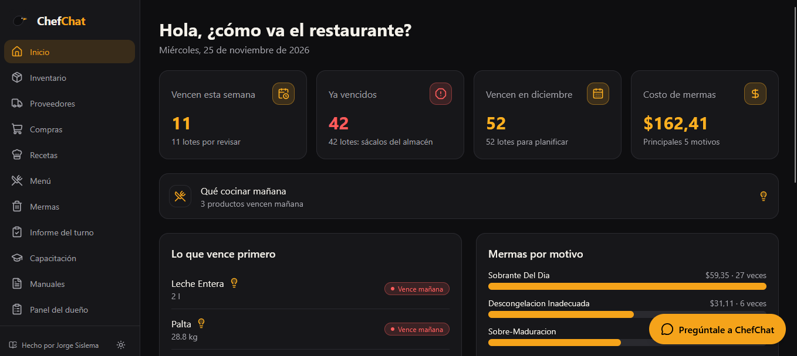

# ChefChat Pro 🍳



Asistente con IA para el dueño de un restaurante. Controla inventario y vencimientos, mermas, capacitaciones con exámenes y documentos. Responde con los datos reales del negocio y cita los manuales.

Se usa de dos formas:
- **Web local** (nueva): `http://127.0.0.1:8765`. Es la forma recomendada.
- **Escritorio** (PyQt6): `python main.py`.

## Qué hace

- **Vencimientos**: "¿qué vence en diciembre?", "¿qué vence en 2 semanas?", "¿qué ya venció?". Se responde con SQL directo, sin IA, para no inventar datos.
- **Inventario, mermas y personal**: stock por producto, costo de mermas por motivo, personal por cargo y turno.
- **Manuales y capacitaciones (RAG)**: busca en los manuales por relevancia (SQLite FTS5). La IA responde solo con los fragmentos hallados y cita documento y sección. Si no hay nada, lo dice.
- **Exámenes**: modo práctica (feedback al instante) y modo evaluación (con tiempo, nota mínima 80 y 2 intentos). Las preguntas salen de los manuales y **el dueño las aprueba** antes de usarse.
- **JEV (modelo juez)**: puntúa cada pregunta generada (¿es correcta y se responde con su fuente?) y juzga las pruebas del chat.
- **Guardrails, HITL y telemetría**: protección contra inyección de prompts, aprobación humana para Word/Excel y registro de métricas.

## Estructura

```
ChefChat/
├── main.py                 # App de escritorio (PyQt6)
├── server/                 # API local (FastAPI) y arranque: python -m server
├── web/                    # Pantalla web (React + TypeScript + Tailwind + Vite)
├── gui/                    # Ventanas de la app de escritorio
├── agents/
│   ├── orchestrator.py     # Orquestador: datos directos -> RAG -> herramientas -> IA
│   ├── vencimientos.py     # Respuestas directas desde la base (sin IA)
│   ├── consulta_chat.py, menu_chat.py, contexto.py   # Recetas, proveedores y menú en el chat
│   └── multiagent.py, tools.py, mcp_client.py, alertas.py
├── core/
│   ├── config.py           # Proveedores de IA y claves
│   ├── normalizar.py       # Normaliza textos antes de guardar (evita duplicados)
│   ├── unidades.py, formato.py   # kg/g/l/unidad y dinero ($1.234,56)
│   ├── jev.py              # Cliente de JEV (modelo juez)
│   └── models.py, security.py, rag_classifier.py
├── data/
│   ├── esquema.py          # Tablas nuevas (se crean solas al arrancar)
│   ├── inventario.py, proveedores.py, recetas.py, menu.py, carga.py
│   ├── compras.py, conteos.py, turnos.py, balance.py, analisis.py
│   ├── rag_docs.py         # RAG de manuales (fragmentos + FTS5)
│   └── db_manager.py, rag_store.py, menu_semanal.py, vinculos.py
├── examenes/
│   ├── servicio.py         # Banco, intentos, notas, reporte
│   └── generador.py        # Genera preguntas desde los manuales y las puntúa con JEV
├── evaluation/             # Banco de 200 preguntas y pruebas del chat
├── ops/, prompting/        # Guardrails y optimizador de prompts
├── scripts/                # Utilidades y datos de demostración (ver abajo)
├── tests/
├── data_source/            # Recetas, catálogo y lotes en CSV
├── docs/                   # Planes y diseño (exámenes, etapas, balance del turno)
└── chefchat.db             # Base SQLite (no se sube a git)
```

## Instalación

```bash
git clone <url-del-repo>
cd ChefChat
python -m venv .venv
.venv\Scripts\activate
pip install -r requirements.txt
copy .env.example .env      # y completa tus claves
```

Para construir la pantalla web (requiere Node 22+):

```bash
cd web
npm install
npm run build               # genera web/dist, que el servidor ya sirve
```

## Uso

```bash
# Web: desde la carpeta raiz del proyecto (H:\git\ChefChat), no desde web\
python -m server            # luego abre http://127.0.0.1:8765
# o simplemente:
.\iniciar.ps1

# Desarrollo de la web (recarga en vivo; necesita el servidor abierto en otra terminal)
cd web
npm run dev

# Escritorio
python main.py
```

El servidor solo escucha en `127.0.0.1`. Para otro puerto: `CHEFCHAT_PORT=8091`.

### Pantallas web
Inicio (resumen del día), Inventario (existencias, vencimientos, lotes, productos y conteo), Proveedores, Compras, Recetas, Menú, Mermas, Informe del turno (con el balance), Capacitación (para el trabajador), Manuales y Panel del dueño (preguntas, resultados, análisis y cambios). El asistente es la burbuja «Pregúntale a ChefChat» en todas las pantallas.

El logo va en `web/public/logo.png`. Si no existe, se muestra un mirlo dibujado.

## Configuración de IA

Las claves van en `.env` (no se sube a git). Plantilla en `.env.example`.

| Proveedor | Variables |
|---|---|
| **custom** (100milionseek, recomendado para pruebas gratis) | `HMS_API_KEY` o `CHEFCHAT_CUSTOM_API_KEY`, `CHEFCHAT_CUSTOM_BASE_URL`, `CHEFCHAT_CUSTOM_MODEL=deepseek-v4.1-flash-free` |
| JEV (modelo juez) | Misma clave. Modelo `jev-1.13-free`, ruta `POST /v1/systemone` |
| SenseNova | `CHEFCHAT_SENSENOVA_API_KEY`, `CHEFCHAT_SENSENOVA_BASE_URL`, `CHEFCHAT_SENSENOVA_MODEL` |
| OpenRouter, OpenAI, Gemini, Claude, DeepSeek, OpenCode | `CHEFCHAT_<PROVEEDOR>_API_KEY` |
| Ollama (local) | `ollama pull llama3.2` |

Elige el proveedor con `CHEFCHAT_AI_PROVIDER` (por ejemplo `custom`). El servidor usa `custom` solo si hay `HMS_API_KEY` y no definiste otro.

## Datos y utilidades

```bash
python scripts/unificar_duplicados.py       # une duplicados (hace copia de respaldo)
python scripts/seed_lotes_diciembre.py      # lotes FICTICIOS que vencen en las próximas 8 semanas
python scripts/generar_preguntas.py         # genera preguntas de examen (quedan "pendientes")
python scripts/etapa_b_datos.py             # proveedores, precios, ventas, compras, conteos y balance FICTICIOS (repetible)
python scripts/etapa_b_datos.py --solo balance   # solo una parte: ingredientes, proveedores, ventas, compras, conteos o balance
python scripts/security_scan.py             # busca claves o datos personales escritos en el código
python -c "from data import rag_docs; print(rag_docs.reindexar())"   # reindexa los manuales
```

- Al guardar productos o mermas se normalizan mayúsculas, acentos y espacios (`core/normalizar.py`). La base tiene un índice único en el nombre del producto.
- Los lotes de prueba y las preguntas generadas son datos de demostración.

## Pruebas

```bash
# Todo el backend (nunca toca tu chefchat.db: cada prueba usa una copia)
python -m pytest tests -q

# Pantalla web
cd web
npx tsc --noEmit
npx vitest run

# Banco de 200 preguntas contra el chat real (usa tu IA)
python evaluation/correr_banco.py --modo chat

# 30 preguntas de manuales, juzgadas por JEV
python evaluation/probar_rag_30.py 30
```

### Últimos resultados medidos (25 nov 2026)

| Prueba | Resultado |
|---|---|
| Backend completo (`pytest tests`, incluye la app de escritorio) | 330 pasan, 4 se saltan |
| Pruebas de la web (Vitest) | 132 pasan |
| Pruebas con clics reales en Edge (sobre una copia de la base) | 62 flujos pasan |
| Banco de 200 preguntas (vencimientos, stock, mermas, personal) | 200/200 |
| 30 preguntas de manuales, juzgadas por JEV | 28/30 |

Las pruebas de la app de escritorio usan una IA falsa: no llaman a ningún proveedor.

## Proveedores, recetas y menú

- **Proveedores**: quién vende qué y a qué precio, con historial, "el más barato" y aviso si un precio sube más de 10 %. Los datos de la demostración son ficticios.
- **Recetas**: 280 recetas de `data_source/1_recetas`. El **costo por plato** es la columna `Costo_Estimado_USD` de tus archivos. El costo calculado con precios de proveedores es un dato secundario. Las recetas de eventos y las 5 de `recetas_principales.csv` (valores de 18 a 35, parecen precios) no entran a los menús diarios.
- **Menú**: costo por persona de desayuno, almuerzo, merienda y cena; menú de 1 a 7 días con tope de costo y sin alérgenos; qué cocinar con lo que vence; y qué hacer con los sobrantes. Todo se calcula con código (`data/menu.py`). El asistente responde estas preguntas en el chat sin inventar platos ni precios.
- **Cargar recetas y manuales**: botón "Cargar recetas" (CSV con las columnas de `data_source/1_recetas`, separado por coma o punto y coma) y botón "Cargar manual" (Word, PDF, texto o Markdown, hasta 5 MB). Se revisa cada fila, se dice qué se rechazó y por qué, y el asistente puede usar lo nuevo de inmediato. Si cargas otra vez el mismo ID de receta o el mismo manual, se actualiza (no se duplica). Un PDF escaneado como imagen no se puede leer.
- **Asistente**: responde con código y la base de datos (sin inventar) recetas por ingrediente ("recetas con pollo sin lácteos"), la receta de un plato con ingredientes y pasos, recetas para aprovechar la merma, y preguntas de proveedores y precios ("¿quién vende pollo?", "¿qué vende Carnes del Valle?", "¿qué precios subieron?"). Lo demás pasa a la IA con los datos de la base y de los manuales como contexto. Nunca contesta en blanco.
- Alérgenos: se revisan en la receta y en sus ingredientes. Ante la duda se excluye el plato. Revisa siempre con el chef.

## Editar datos y análisis del dueño

- **Inventario → Lotes**: agregar, cambiar (cantidad, unidad, fechas) y quitar lotes. Si escribes un producto nuevo, se crea.
- **Inventario → Productos**: cambiar nombre, categoría, tipo (alimento o limpieza) y vida útil; ver y cambiar el precio en cada proveedor; sumar un proveedor que lo vende. El filtro «Sin clasificar» ayuda a ordenar los productos creados desde las recetas. Un producto solo se puede quitar si nada lo usa.
- **Proveedores**: editar datos, quitar un proveedor (sus precios se conservan), cambiar el precio de cada producto y quitar un producto que ya no vende.
- **Panel del dueño → Análisis**: merma por mes, motivo y producto; merma recuperada; producido contra vendido (con el dinero que sobra); y los platos que más y menos dejan. Cada bloque dice de qué fechas son sus datos. Solo compara un mes con otro si los dos tienen al menos 20 días con datos.
- **Panel del dueño → Cambios**: registro de todo lo que se cambia en precios, productos, lotes, proveedores y sobrantes.
- **Menú → Sobrantes**: «Lo usé» (con el valor recuperado), «Lo boté» y «Lo doné».
- Al cambiar un precio, el costo de las recetas se recalcula solo. Las ventas de la demostración son ficticias (`scripts/etapa_b_datos.py --solo ventas` las vuelve a crear).
- Para probar o hacer una demo sin tocar tus datos: `$env:CHEFCHAT_DB_FILE="C:\ruta\copia.db"` antes de `python -m server`.

## Compras, costo real e informe del turno

- **Compras**: registrar lo que se compra (proveedor, producto, cantidad, precio). Calcula el total al momento (2000 g a $9,50 el kg = $19,00), puede sumar el lote al inventario y guardar el precio como el de hoy del proveedor. Una compra mal anotada se puede anular; su lote se quita solo si nadie lo usó.
- **Costo real** (Panel → Análisis): compara lo gastado en alimentos con lo que debió costar lo vendido según las recetas, y reparte la diferencia en sobreproducción, merma anotada y «sin explicar». Sin conteos de inventario se supone que lo comprado se usó en el mismo periodo: con menos de 28 días de datos, el sistema avisa que es poco preciso.
- **Informe del turno**: se llena solo con lo que ya está en la base (producido y vendido, merma del día, sobrantes, compras, incidencias y el personal del turno, sin quien descansa o está ausente). El chef corrige, agrega incidencias y observaciones, guarda borradores y firma. Firmado ya no cambia, sus incidencias pasan a la bitácora y se puede imprimir. El historial muestra todos los informes.
- Turnos: Mañana = desayuno y almuerzo; Tarde = merienda y cena; Noche = sin servicio. Las mermas no tienen turno: el informe muestra las del día y lo dice.
- Datos de demostración: `python scripts/etapa_b_datos.py --solo compras` crea compras ficticias (marcadas) coherentes con las ventas ficticias.
- **Conteo de inventario** (Inventario → Conteo): se arma una hoja con lo que dice el sistema, se anota lo que hay de verdad (se guarda de a poco y se puede imprimir para contar a mano) y se cierra. Al cerrar se puede ajustar el inventario a lo contado: lo que falta sale de lo que vence antes y lo que sobra entra como lote de ajuste. Con dos conteos cerrados, el costo real es exacto: inventario inicial + compras − inventario final. `python scripts/etapa_b_datos.py --solo conteos` crea conteos ficticios a fin de cada mes.

## Balance del turno (kilos y unidades)

Sirve para ver la merma que nadie anota (lo que queda en la máquina, se riega o se come el personal). Detalle en `docs/PLAN_BALANCE_TURNO.md`.

- **La cuenta**: `entró = salió bueno + pérdida normal + anotado + sin explicar`. Entró = lo que bodega entregó menos lo devuelto. Salió bueno = unidades × peso por unidad (o el peso de la receta). Anotado = merma pesada + comida del personal + residuo de limpieza + muestras. **Sin explicar positivo = falta.**
- **Semáforo**: Alarma si lo sin explicar pasa la tolerancia de la receta (2 % por defecto); Cerca si pasa el 75 % de la tolerancia.
- **Por ingrediente**: entregado − uso según receta − merma. Primero sale el que más dinero pierde: ahí está la fuga.
- **Por unidades**: producido (lo dice el turno) contra recibido (lo cuenta otra persona en mostrador o despacho).
- **Dónde**: Informe del turno → Balance del turno (botones para anotar entregas, devoluciones, merma, comida del personal y residuo de limpieza; sale al imprimir y se congela al firmar). Recetas → Estándar de producción. Panel → Análisis → Pérdida sin explicar por turno. Inventario → Productos → Editar → peso de 1 unidad o 1 litro.
- Una entrega de bodega descuenta el inventario (lo que vence antes primero); una devolución lo vuelve a sumar.
- Datos de demostración: `python scripts/etapa_b_datos.py --solo balance` crea 7 días de entregas, mermas y comida del personal ficticias (sin tocar el inventario). El sábado 21 nov por la tarde pierde 7 % de chocolate para ver la alarma.

## Seguridad

- Claves en `.env` o en el keyring del sistema. Nunca en el código.
- Guardrails contra inyección de prompts. Sandbox para Office.
- La API solo escucha en `127.0.0.1`.
- Los exámenes no muestran la respuesta correcta al trabajador en modo evaluación.
- Un proveedor de terceros ve tus mensajes. Usa datos ficticios en las pruebas.

## Limitaciones conocidas

- La búsqueda en manuales es por palabras (FTS5), no por significado. Funciona bien con preguntas claras.
- Proveedores, precios, ventas, compras, conteos y balance de la demostración son FICTICIOS (marcados `es_demo`).
- 15 lotes del inventario apuntan a productos que no están en el catálogo.
- Quedan 3 preguntas de examen «pendientes»: se aprueban en el Panel del dueño.
- La app de escritorio es la versión anterior: lo nuevo (compras, conteo, turno, balance) solo está en la web.

## Documentación

- `docs/PLAN_ETAPAS.md`: qué pidió el cliente y en qué orden se hizo.
- `docs/PLAN_BALANCE_TURNO.md`: balance del turno en kilos y unidades.
- `docs/DISENO_EXAMENES.md`: diseño del módulo de exámenes.

## Autor

Hecho por **Jorge Sislema**. Licencia MIT.

*Última actualización: 25 de noviembre de 2026*
